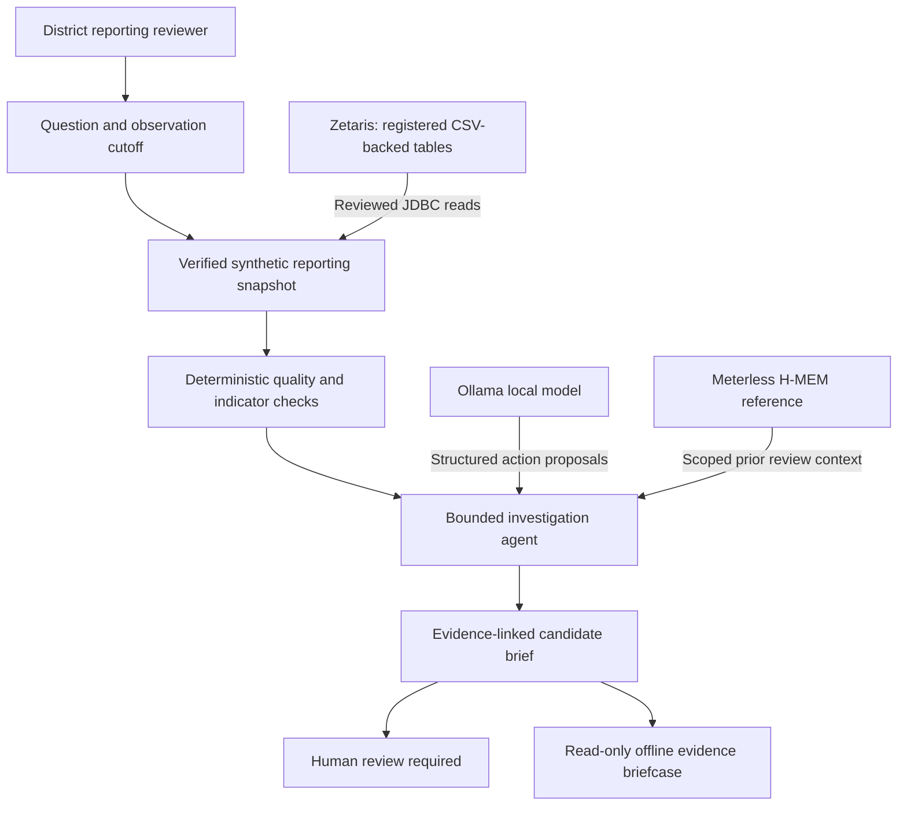

# AfyaEvidence

**Understanding changes in malaria reporting, with evidence that people can check.**

AfyaEvidence is an experimental AI investigation assistant for district-level malaria reporting. It helps a reviewer answer a practical question: *when reported malaria indicators change, what does the available reporting evidence actually explain?*

A rise in reported positives does not always mean the underlying situation has changed. A late correction, a withdrawn report, a missing facility or more people being tested can alter the figures. AfyaEvidence examines those possibilities before preparing a traceable explanation for a human reviewer.

The current project works with **fictional facilities and synthetic aggregate records**. It is not deployed disease surveillance, a diagnostic tool or a system that declares outbreaks.

## What the agent does

For a selected district, two months and an observation cutoff, AfyaEvidence:

1. Collects a verified snapshot of facility reporting, including the facility register and report-version log.
2. Checks completeness, conflicting records, missing values and revised submissions.
3. Compares raw report totals with accepted, version-aware figures using deterministic calculations.
4. Uses a bounded agent to investigate plausible explanations and draft findings linked to the evidence.
5. Leaves the candidate **awaiting human review**. It cannot approve its own findings or alter source records.

The distinction matters. If an apparent increase comes from counting an older report alongside its replacement, the reviewer should see that clearly. Where a change remains unexplained after the available checks, the system says so rather than assigning a cause.

## Open Agent Hackathon 2026

**Submission track:** The Agent That Can Explain Why  
**Project scope:** Synthetic malaria reporting investigations  
**Source revision demonstrated:** [80fbb9f](https://github.com/buriro-ezekia/afyaevidence/tree/80fbb9fd52c2ecc0b3f987e476e3908c6fbc4a71)  
**Development branch:** `work/keycloak-live-acceptance`  
**Demonstration video:** [AfyaEvidence — Open Agent Hackathon 2026](https://youtu.be/h3Reux-_e7A) (illustrated walkthrough; not a recording of live service execution).

The [investigation and architecture guide](docs/HACKATHON_JUDGES_GUIDE.md) describes the workflow, its evidence boundaries and the demonstration. The [verification record](docs/HACKATHON_PHASE1_FREEZE.md) contains the source revisions and evidence hashes.

### How the sponsor technologies contribute

| Technology | Role in the demonstrated workflow |
| --- | --- |
| **Zetaris** | Reads registered synthetic CSV-backed reporting tables through reviewed JDBC access. The application does not grant the model arbitrary SQL access. |
| **Meterless H-MEM reference** | Provides a pinned, locally running Node 24 memory bridge for scoped historical review context, with provenance and chronological limits. |
| **Ollama** | Runs the local model used by the bounded agent to select allowed investigation actions and propose an explanation. |
| **Python analysis and review controls** | Own deterministic metrics, evidence validation, source immutability and the human decision boundary. |

The successful integrated demonstration used Zetaris, Ollama and the pinned H-MEM reference. **No historical memory notes were recalled in that run**; the memory connection worked, but those notes did not contribute to its explanation. Do not confuse this with independent verification of external service logs.

## Demonstrated results

The following results describe local synthetic verification, hosted fixture testing and a separately observed integration exercise. They do not establish production or clinical readiness.

| Check | Observed evidence |
| --- | --- |
| Full local regression, 26 October 2026 | **335 tests passed** in 71.306 seconds |
| Synthetic evaluation | **15** reproducible snapshots, **16** evaluation scenarios |
| Agent fixture evaluation | **32** scripted runs across standard and CPU profiles |
| Hosted verification | CircleCI **pipeline #26**: Python 3.12, 3.13 and 3.14 all passed at commit `d3941a5` |
| Integrated demonstration, 25 October | Actual Zetaris + Ollama + H-MEM operation reported **PASS**; two model calls, five tool calls, zero repairs |
| Candidate outcome | `reporting_artefact_supported`, `awaiting_human_review` |
| Receipt integrity | Read-only source freeze **PASS**; previous integrated receipt SHA-256 matched the preserved witness |

The automated fixture suite does **not** call live Zetaris, Ollama or H-MEM services. The earlier integrated operator receipt and redacted witness document that separate demonstration. The local receipt is **not** an independent network attestation.

## Try the synthetic checks

The safest starting point is the deterministic fixture suite. It requires no patient records, Zetaris credentials or live model endpoint.

Requirements: **Ubuntu/WSL**, **Python 3.12 or later**, **Node.js 24** and the optional Python identity dependencies. From a fresh clone of this development branch:

```bash
git clone --branch work/keycloak-live-acceptance \
  https://github.com/buriro-ezekia/afyaevidence.git
cd afyaevidence

python3 -m venv .venv
source .venv/bin/activate
python -m pip install '.[identity]'

# With nvm installed and Node.js 24 available:
source "$HOME/.nvm/nvm.sh"
nvm use 24

python scripts/verify_identity_worker.py --fixtures
python -m pip check
```

The verifier runs the Python tests, deterministic data and agent checks, H-MEM reference tests and isolated package checks. It prints `IDENTITY_WORKER_TESTS=PASS` only when all included checks succeed, and saves local logs in `runtime/identity-verification-…`.

For a smaller, fully scripted agent exercise:

```bash
python scripts/run_agent.py \
  --data-mode fixture \
  --snapshot data/synthetic/fx_32e8b610 \
  --model-provider scripted \
  --output runtime/agent-fixture-demo.json
```

Choose a different output filename if it already exists. The scripted provider verifies the investigation workflow; **it is not a test of live language-model reasoning**.

To reproduce the real Zetaris–Ollama–H-MEM integration, consult the [hackathon readiness runbook](docs/HACKATHON_SUBMISSION_READINESS.md). It requires your own configured services, JDBC driver and private local credentials. The application never substitutes fixture data when a live source fails.

## Architecture in brief



The host controls tool permissions, calculations and evidence references. A model cannot execute arbitrary SQL, edit reporting records, approve a candidate or turn historical memory into a current indicator.

The [investigation guide](docs/HACKATHON_JUDGES_GUIDE.md) includes an example of the reporting-revision explanation and its limitations.

## Offline reading and security limits

A completed synthetic investigation can be exported as a **read-only HTML evidence briefcase** for viewing without connectivity. Signed offline package experiments add hash checks, signatures and publisher-registry verification. They do **not** enable offline authentication, source refresh, clinical approval or synchronisation of reviewer decisions.

The repository also contains experimental Keycloak-backed reviewer identity and supervised worker components. Local access-control tests are not production authorisation.

**Production release remains blocked.** The candidate Keycloak container still has reported security findings; independent security assurance, deployment controls and clinical governance have not been completed. Do not use the prototype for patient care or real public-health decisions.

## Repository map

| Location | Purpose |
| --- | --- |
| `src/afyaevidence/` | Analysis contracts, agent, adapters and local review services |
| `data/synthetic/` | Reproducible fictional reporting snapshots |
| `evals/` | Independent scenario expectations; not supplied to the agent |
| `bridges/hmem/` | Pinned Meterless H-MEM reference and attribution |
| `scripts/` | Verification, demonstrations, evidence export and audits |
| `tests/` | Regression and security-boundary tests |
| `docs/` | Technical design, provenance, security and operator runbooks |
| `.circleci/config.yml` | Hosted synthetic-only verification matrix |

## Development and contribution

The working implementation is maintained on `work/keycloak-live-acceptance`. Earlier feature and identity changes remain under review and have not been merged into `main`. The demonstrated source revision is pinned above; later documentation updates should not be mistaken for the tested application revision.

Changes should preserve immutable reporting inputs, evidence provenance and reviewer authority. Tests must distinguish scripted fixtures from actual Zetaris, Ollama and H-MEM service interactions. Before a release is considered, source licensing, security findings and operational controls require separate review.

Use professional UK English and report verification outcomes precisely, including checks that are blocked or have not been run.

## Further reading

- [Judges' quick guide](docs/HACKATHON_JUDGES_GUIDE.md)
- [Demonstration video production notes](docs/HACKATHON_VIDEO_PRODUCTION.md)
- [Phase 1 evidence freeze](docs/HACKATHON_PHASE1_FREEZE.md)
- [Agent design and investigation controls](docs/AGENT_LOOP.md)
- [Synthetic data and evaluation](docs/SYNTHETIC_DATA.md)
- [Meterless memory bridge](docs/HMEM_BRIDGE.md)
- [Offline evidence briefcase](docs/OFFLINE_EVIDENCE_BRIEFCASE.md)
- [CircleCI verification](docs/CIRCLECI_SYNTHETIC_SETUP.md)
- [Residual Keycloak security](docs/KEYCLOAK_RESIDUAL_SECURITY.md)

**AfyaEvidence's aim is straightforward: make the evidence behind an unusual reporting change easier to inspect, while keeping the decision with the person responsible for it.**
