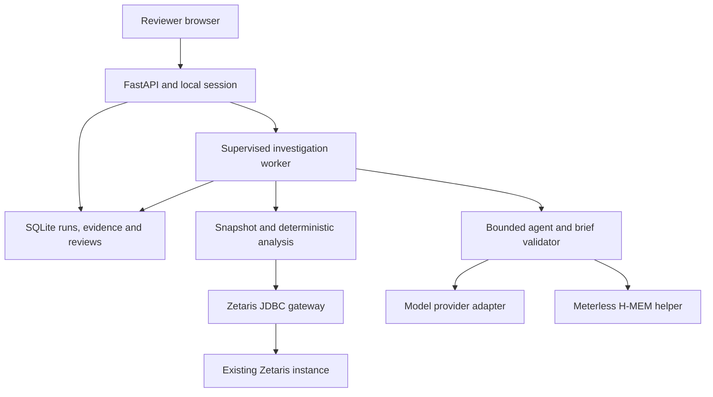
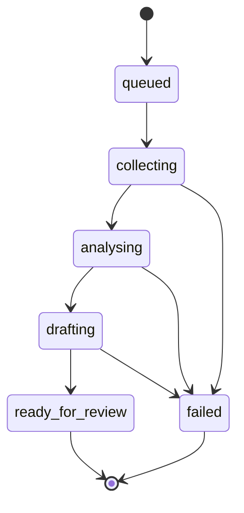

# AfyaEvidence architecture

Version 0.1 design | 21 October 2026 | Proposed implementation, not a verified application

## 1. User, question and outcome

The primary user is a district reporting reviewer. The first product answers: **Why did reported confirmed malaria episodes change between these two months, and which evidence should I inspect next?** The reviewer chooses district, comparison month, target month and observation cutoff. A structured investigation presents calculated changes, reporting-quality findings, possible explanations, limitations and suggested checks. It ends with an explicit human disposition, not an automated public-health decision.

This is an aggregate-data review prototype. Monthly data and 24 months of synthetic history are suitable for testing the software workflow; they do not establish an operational early-warning system, calibrated anomaly threshold or forecasting model.

### Initial scope

- One fictional district D001; six fictional facilities with stable registry membership.
- January 2024 through December 2025: 144 expected facility-months, plus any extra report versions.
- Three independently described logical sources: aggregate monthly reports, reporting receipts/versions and a facility registry. Their physical storage may initially be shared; do not claim federation across independent systems until demonstrated.
- Three core investigations: testing expansion, revision double-counting and a residual unexplained increase.
- One review screen, one evidence panel, an investigation history and Markdown/JSON exports.
- Synthetic aggregate data only; no patient records, diagnosis, treatment, outbreak declaration or source edits.
- Climate variables, real DHIS2 integration, forecasting, population incidence and multi-district deployment are later increments.

## 2. Technology and runtime

Use a **Python modular monolith**: FastAPI for the local HTTP surface, Pydantic for strict contracts, the Python standard library/Decimal for small deterministic calculations, SQLite for run/review state, and a same-origin HTML/CSS/JavaScript interface. Avoid a second frontend build and distributed infrastructure in the first sprint.

Use a managed **Node/TypeScript H-MEM helper** behind a narrow JSON-lines subprocess adapter. This is one specialist integration, not a separate publicly accessible service. Use the actual pinned Meterless reference, retain its licence/attribution, and disclose its mock embedder and JSON-store limitations. The language bridge is justified by using the supplied reference rather than claiming an unverified Python reimplementation is equivalent.

The model provider is independent of memory. First verify the user's existing Ollama endpoint from the Ubuntu process that will run the application. Use a compact installed model only after structured-action evaluation. Meterless Runtime is an optional provider, subject to actual endpoint, token, routing-mode and hardware availability. A provider change never changes calculation or approval policy.

Run the Python application inside Ubuntu/WSL alongside access to the existing Docker Desktop Zetaris instance. Use an operator-selected application port, initially 8010. The browser connects to the application; it does not connect to JDBC or receive provider credentials. GitHub hosts source and CI, not the local Zetaris instance. GitHub Pages cannot host this backend.

## 3. Component topology



Zetaris reads the three registered source tables. The operator controls their staging/registration path. The application's SQLite database stores investigation state; it is not a replacement analytics source in live mode. H-MEM stores scoped prior review context; it is not the source of current health indicators.

### Ownership and dependency rules

| Module | Owns | Must not own |
|---|---|---|
| `domain` | Validated identifiers, indicator definitions, quality findings and evidence contracts | JDBC, HTTP, prompt text or UI state |
| `data` | Dataset manifests, immutable snapshots, version selection and join validation | Expected scenario answers |
| `analysis` | Exact arithmetic, cohort matching, quality checks and contribution comparisons | LLM-written arithmetic or clinical thresholds |
| `integrations/zetaris` | Reviewed SELECT templates, bounded retrieval and result normalisation | Arbitrary model SQL or provisioning |
| `agent` | Allowed actions, call budgets, hypothesis selection and validated brief proposals | Human approval, source mutation, filesystem/network tools |
| `integrations/model` | Provider protocol, timeout/status mapping and response parsing | Domain calculations or approval policy |
| `integrations/meterless` | H-MEM bridge, provenance and enforced memory scope | Authoritative current measurements or answer keys |
| `storage` | Run/evidence/audit/review persistence and memory outbox | Modifying source CSVs or Zetaris tables |
| `api` and `web` | Request/session checks, progress, evidence inspection and reviewer actions | Secret exposure or accepting model-supplied reviewer identity |

Domain and analysis modules depend on contracts, not adapters. Fixture and live gateways implement the same interface and are explicitly selected. Live failures do not fall back to fixtures.

## 4. Data path and the first feasibility gate

`SELECT 1` proves transport/authentication, not access to project data. Before building the model loop:

1. Generate a tiny synthetic sample and inspect existing Zetaris objects read-only.
2. Select the supported onboarding route on this installation. Candidate routes are reachable file storage registered as filestore tables or a dedicated project database registered as a source. Do not write an assumed CSV `PATH`, create syntax or network address into the production plan.
3. Keep project data separate from Zetaris's internal PostgreSQL metadata database. If a project database is needed, use a dedicated instance/schema and account.
4. Stage/preview the exact setup statements. Execute project provisioning only within the user's authorised implementation scope; no agent tool performs it.
5. Retrieve one project table, then all three tables, through JDBC. Verify types, unique keys, versions, returned rows and known aggregates. Record exact object names and the tested setup recipe.
6. Demonstrate a reviewed three-table join as an integration probe, checking it does not multiply report versions. Runtime can still use simpler bounded source reads.

For 144 expected rows, start with three simple bounded source reads into an immutable run snapshot, followed by canonicalisation and analysis in Python. This avoids making the first milestone depend on unverified window functions, CTEs, prepared-statement support or complex Lightning syntax. Later move verified aggregations into SQL and test parity with the reference calculations.

Each run pins an immutable dataset batch, schema version, source-file hashes, row counts and observation cutoff. Fetch only the published batch. Recompute normalised source-content hashes against the manifest; fail if a source changes or is truncated while the snapshot is collected. A live source may not silently change beneath an investigation. Large/real datasets require a later snapshot/transaction design.

### JDBC contract

- JAR supplied by the user: `jdbc/ndp-jdbc-driver-2.4.3.1-7eff043-driver.jar`, resolved to an explicit absolute path in local configuration.
- Class: `com.zetaris.lightning.jdbc.LightningDriver`.
- Local URL: `jdbc:zetaris:lightning@localhost:10000`.
- Python bridge: JayDeBeApi/JPype, with Java and dependency compatibility verified locally.
- Start one JVM per investigation worker process; do not fork an already started JVM, share connections between threads or use hot reload for integration verification.
- Execute one Lightning SQL statement per call. Use a fixed registry of reviewed templates and schema-derived value types. Table identifiers come from trusted configuration, never a prompt.
- Verify JDBC parameter binding on the actual driver. Until proved, restrict values to validated fixture identifiers/months and generate literals through one reviewed renderer. A semicolon/keyword check alone is not an SQL security boundary.
- Use SELECT-only runtime capabilities, scoped application credentials where available, result caps (2,000 rows per source in the initial design) and a visible overflow error. Fetching the cap plus one distinguishes exact-cap results from truncation.
- Close cursor and connection on all paths. Do not substitute a Hive/Spark driver, start Spark, install another analytics engine or automatically change the chosen protocol.
- Driver query timeout/cancellation are unverified until tested. A supervised worker process provides an outer termination boundary; report cancellation limitations honestly.

## 5. Investigation lifecycle



`cancelled`, `timed_out` and `interrupted` are additional terminal execution states. Analytical outcome (`testing_change_supported`, `reporting_artefact_supported`, `mixed`, `unexplained`, `insufficient_data`) and reviewer disposition are separate fields; completing execution does not mean an explanation was established.

1. Validate the request and persist `queued` before spawning work. An idempotency key prevents duplicate creation from a double click.
2. Atomically claim one run. A single worker slot is enough for the first local build; reject or queue additional requests with visible status.
3. Spawn a fresh Python worker using an explicit argv array, no shell. The worker starts its JVM once, collects and hashes the bounded snapshot, then creates deterministic analysis facts.
4. The model may select additional allowed analyses against that snapshot, compare explanations and request supporting record subsets. Scope cannot expand after run creation.
5. Validate the structured candidate brief against the current fact/evidence registry. Render numeric statements from metric references, not from model-authored numbers.
6. Persist the brief, its evidence and provenance atomically before marking `ready_for_review`.
7. The reviewer records accept/request-more-evidence/reject with a reason. This appends a review event and never rewrites data or the original brief.

Use SQLite WAL, short transactions and a busy timeout. Never hold a database transaction while waiting on JDBC/model/helper I/O. The API supervisor tracks the child process and heartbeat. A missing worker marks a run interrupted and offers an explicit new run from the same snapshot; do not silently rerun model calls after restart. Store monotonic event sequence numbers per run and append history rather than overwriting it.

### Proposed operational limits

| Limit | Initial setting | Behaviour |
|---|---:|---|
| Active investigation workers | 1 | Queue requests and show queue state |
| Expected facilities / months | 6 / 24 | Reject scope outside registered synthetic data |
| Source row cap | 2,000 each | Fail snapshot creation on overflow |
| Model calls | 4 | Include repairs in the same budget |
| Agent tool calls | 10 | Reject repeats without new arguments/evidence need |
| Model-call timeout | 180 seconds | Record a provider timeout, not an empty successful brief |
| Investigation deadline | 600 seconds | Stop dispatching new work; supervisor termination target tested separately |
| Memory results | 3 | Scope-filter and revalidate provenance before injection |
| Concurrent model requests | 1 | Keep local resource usage bounded |

These are proposed engineering budgets, not measured performance promises or medical thresholds. Provider cancellation and worker cleanup must be tested before claiming a hard wall-clock limit.

## 6. Bounded agent and evidence validation

Use a small explicit state machine rather than a multi-agent framework. Each provider response must be a strict JSON action: a named allowed tool with validated arguments, or a proposed brief. A provider may use native tool calls if tested; otherwise use the same strict JSON action envelope. Never parse a model answer as executable Python/SQL.

Mandatory deterministic baseline facts are always collected. The agent's useful choice is which follow-up comparisons and evidence to inspect, whether explanations conflict and where to stop as inconclusive. This creates a genuine bounded investigation rather than a replayed explanation disguised as an agent.

Every tool receives server-injected `run_id` and `snapshot_id`. It cannot choose a new dataset, district, cutoff or arbitrary table. Calculated facts retain numerator, denominator, unit, cohort and source record IDs. Scope and excluded records are visible alongside totals.

Model output contains claim types, fact references, supporting/counter-evidence IDs and qualitative reasoning. Numeric clauses are server-rendered from verified facts. Unknown IDs, mismatched scope, invented thresholds, malformed output or inconsistent finding categories fail validation and allow at most one repair within the global budget. Semantic truth is not fully guaranteed by schema validation: scenario evaluation and human review assess causal overstatement and unsupported interpretations. Never describe a heuristic score as a calibrated probability.

On final validation failure, preserve the valid deterministic evidence and expose `brief_generation_failed`. A clearly labelled calculation report may still be viewed, but it is not a successful live agent investigation.

## 7. Meterless memory and model adapters

### H-MEM: required sponsor integration for the proposed build

At source commit `1742dec56a66e58eef9dda2d2b865823758ca8cd`, Meterless includes a runnable TypeScript H-MEM reference with mock hash embeddings and optional JSON persistence. Pin the exact source rather than following `main`. Use an allowlisted dependency download/setup script and record source hashes/licences in `integrations/meterless/upstream.lock.json`; do not copy the starter's `node_modules` tree.

The Python adapter starts one Node helper per investigation, with fixed executable/entrypoint arguments and no network listener. Before launch, the worker acquires an operating-system exclusive lock on the trusted scope store and retains it for the helper's lifetime. All helper users, including the review-outbox dispatcher, must acquire that same lock; outbox writes wait while a run holds it. For the Ubuntu/WSL MVP use a tested POSIX file lock, not only a process-local semaphore. JSON-lines requests have request IDs, an operation enum, strict payloads and size/time limits. Stdout contains protocol JSON only; stderr is bounded diagnostic output. The helper exposes `recall`, `remember_reviewed_note`, `audit` and `health` to the host application. Only `recall` is model-visible.

Use a separate store directory for each trusted dataset-family/district scope; scopes derive from the server registry, not caller-supplied paths. Apply exact scope/provenance filters again in Python. Child helper operations are serial and bounded. Validate oversized/malformed output, process exit, restart persistence and cleanup.

Memory may hold approved reviewer notes or prior scoped investigation context with original run, snapshot, date, reviewer event, source and supersession links. Freeze a separate `memory_as_of_utc` when the run starts: this is not the reporting-data cutoff. Only notes existing by that memory cutoff are eligible; record the exact notes injected for replay. Recall is contextual history, never evidence of a current case count. Stale numeric information cannot enter the current fact registry. Prior notes must be rechecked against current source records before informing a new conclusion.

Use a SQLite outbox after a review transaction to synchronise a reviewed note into H-MEM. Make retries idempotent using a stable outbox event identity in the memory source and a bridge receipt. Under the scope lock, check existing records for that identity before adding; the reference allocates memory IDs itself. Test the crash between writing memory and acknowledging the outbox, and detect incomplete/corrupt reference JSON after a crash. SQLite review events remain authoritative; memory is a rebuildable projection, not a distributed transaction or exactly-once guarantee supplied by upstream. A successful review remains durable if memory fails; display pending memory sync and do not claim memory success.

For the MVP disable automatic dreaming, consolidation, cross-district recall and inference-based promotion to approved status. Treat recalled notes as untrusted data; they cannot change tool policy. The reference is a prototype, not a production-grade semantic memory database or tamper-proof audit store.

### Model provider

Define `ModelProvider.next_action(context, available_tools) -> ActionResult` with model identifier, latency and error status. Implement scripted fixture mode for CI, Ollama after local verification, and optional Meterless Runtime after a separate probe. Preserve mode labels through UI, exports and evidence records.

For Meterless Runtime the documented contract uses an OpenAI-compatible base such as `http://127.0.0.1:8088/v1`, a real bearer token, app/scope headers and routing modes discovered from `/v1/models`. A `200` health endpoint alone does not establish authorised model access; `401`/`403` are unauthorised, not offline. Do not assume the user's machine can run the required gateway models or that an Ollama model name equals a Meterless routing mode. Only explicit endpoint configuration is needed in the first build; scanning local ports is deferred.

The app can demonstrate actual H-MEM usage with a separate Ollama provider. Do not claim Meterless Runtime inference unless it is the provider actually called. Confirm current sponsor-specific submission requirements separately from technical integration.

## 8. Interface, API and review authority

The UI has a scoped investigation form, execution progress, deterministic indicator comparison, possible-explanation cards, supporting/counter-evidence inspection, limitations, a reviewer disposition form and export/history controls. It always identifies synthetic data and actual fixture/live/provider/memory modes. Technical integration details belong in an expandable diagnostics panel, not the main health-review flow.

Local first deployment binds to `127.0.0.1`. Establish a short-lived HttpOnly/SameSite session and verify Origin plus CSRF token on mutations. Human review routes require this browser capability; it is never in model context or exposed as an agent tool. Idempotency plus an expected review revision prevents duplicate/stale decisions. Local actor labels are operator assertions, not verified healthcare identities. Before network deployment, replace local-session assumptions with authenticated user/role controls and HTTPS.

Render external/model text as text with escaping. Do not display raw HTML from a model. Export only the selected synthetic run with its evidence, calculated fact registry and review history. Server paths and credentials are never accepted from the browser.

## 9. Target repository layout

This is the intended implementation tree. Only the design files included in this pack exist so far.

```text
afyaevidence/
  README.md, AGENTS.md, pyproject.toml, .env.example, .gitignore
  requirements.lock                  # resolved/pinned during implementation
  src/afyaevidence/
    config.py, cli.py, worker.py
    domain/                         # types, metrics, findings, evidence
    data/                           # manifests, snapshots, canonical versions
    analysis/                       # quality, comparisons, cohorts
    agent/                          # state machine, tools, prompts, brief validation
    integrations/
      zetaris/                      # JDBC lifecycle and reviewed query registry
      model/                        # scripted, Ollama, optional Meterless provider
      meterless/                    # NDJSON client and provenance checks
    storage/                        # SQLite migrations, repositories, memory outbox
    api/                            # run, evidence, review and status routes
    web/                            # same-origin templates and static assets
  bridges/hmem/                     # pinned TS adapter, package/lock files
  scripts/                          # generate, doctor, register preview, verify
  sql/                              # tested setup recipe and SELECT templates
  data/synthetic/                   # opaque fixture IDs, source tables, manifest
  evals/                            # evaluator-only keys and case definitions
  tests/unit/, tests/contract/, tests/integration/
  docs/, .github/workflows/, .github/ISSUE_TEMPLATE/
```

Keep `evals/` out of runtime package data and application data mounts. Git visibility does not constitute runtime isolation: the agent has no shell/file tool, no arbitrary retrieval path and no access to expected answers through an API. The evaluator selects datasets by opaque ID, not explanation-bearing filenames.

## 10. Verification, delivery and limitations

CI runs deterministic contracts, numerical scenarios, lifecycle/permission tests and synthetic UI smoke without external secrets. A separate Node job runs the pinned H-MEM smoke/persistence/bridge tests. Actual source-backed checks run locally because a GitHub-hosted runner's `localhost` is not the user's WSL machine.

Keep four receipts distinct: fixture CI, live Zetaris custom-data acceptance, real H-MEM lifecycle acceptance and live model/end-to-end acceptance. A skipped or unavailable check is never PASS. Evidence records source revision, dependency lock hash, dataset hash, schema/query/prompt versions, cutoff, provider/model, timestamps, results and failures. Tokens unavailable from a provider remain unavailable, not zero.

An application audit log supports inspection but is not immutable or tamper-proof against local administrators. Synthetic scenarios validate designed behaviours, not clinical effectiveness, deployment readiness or generalisable epidemiological accuracy. Those later claims require appropriate practitioners, real-data governance and external evaluation.

Build in this order: project-data access, synthetic contracts, deterministic analysis, actual H-MEM bridge, bounded model workflow, review UI, live scenario demonstration. Each stage has a concrete acceptance gate in [Implementation](IMPLEMENTATION.md).
