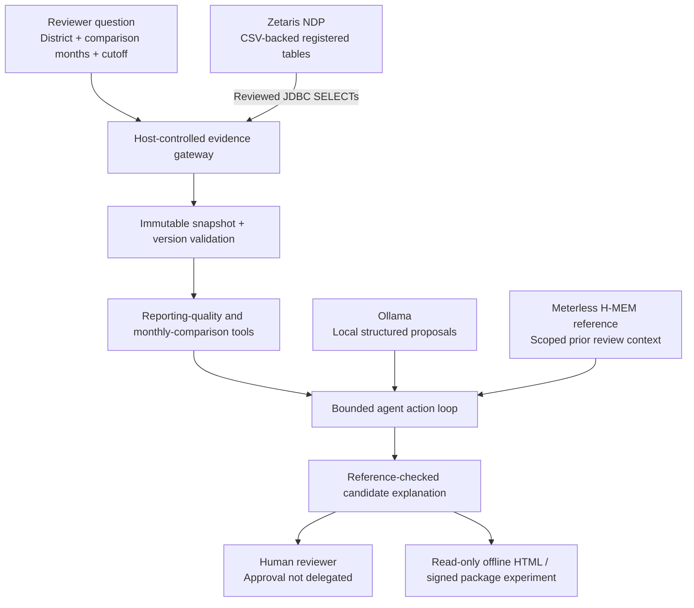

# AfyaEvidence — judges' guide

**Open Agent Hackathon 2026 | Track: The Agent That Can Explain Why**

AfyaEvidence asks a simple but important question: **why did reported malaria indicators change, and what evidence should a district reviewer examine before drawing conclusions?** This guide is a brief tour of the working synthetic prototype and the evidence available to assess it.

## The problem and who it helps

A district reporting officer may see a rise in monthly malaria positives without knowing whether it reflects more testing, late or revised reports, missing facilities or an unexplained change in the accepted figures. Treating every movement as an outbreak signal is not justified. Nor is dismissing an increase simply because reporting issues exist.

AfyaEvidence helps the reviewer distinguish what the data support from what still needs investigation. The candidate explanation is always attributed to verifiable reporting evidence and stays **awaiting human review**.

All demonstrated facility records are fictional and aggregate. This is not a clinical decision-making tool or a deployed surveillance system.

## Agent workflow



**Zetaris** is the read-only reporting data gateway. Synthetic CSV files are staged and registered as Zetaris tables; the application retrieves those through reviewed JDBC queries. JDBC connectivity does **not** establish that PostgreSQL itself is a source federated through Zetaris. The synthetic demonstration should be described as structured CSV-backed tables, not a proven multi-system federation.

**Ollama** supplies local model proposals under a fixed action schema, call budget and host-controlled tool list. Exact arithmetic, canonical report selection and evidence identifiers belong to deterministic code, not the model.

**Meterless H-MEM** is the pinned Node 24 reference implementation. The host determines the data-family and district scope, creation chronology and three-note recall limit. Prior reviewed notes are supporting context, not current source data. In the successful integrated run **zero** notes were recalled, so no claim is made that remembered context influenced its final explanation.

## One scenario judges can follow

The version-revision fixture is `data/synthetic/fx_32e8b610`. It contains six fictional facilities and a report update for one facility. A naïve sum of both report versions would overstate the target month's totals.

| Metric | Before revision-aware selection | Canonical accepted version |
| --- | ---: | ---: |
| Target-month tests | 600 | 500 |
| Target-month positives | 120 | 100 |
| Comparison-month positives | 100 | 100 |

The 20 extra apparent positives come from incorrectly counting an older report version alongside its replacement. AfyaEvidence retains the old version as evidence but does not count it as an additional accepted facility-month. Its supported candidate explanation is `reporting_artefact_supported`, not an outbreak claim.

This is one intentionally constructed synthetic example, **not a finding about a real district**. Other scenarios include expanded testing, unexplained residual changes, invalid/withdrawn reports, missing values and changed reporting coverage.

## Reproduce the fixture checks

From Ubuntu/WSL, install Python 3.12 or newer, Node.js 24 and the Python identity dependencies:

```bash
git clone --branch work/keycloak-live-acceptance \
  https://github.com/buriro-ezekia/afyaevidence.git
cd afyaevidence
python3 -m venv .venv
source .venv/bin/activate
python -m pip install '.[identity]'
source "$HOME/.nvm/nvm.sh"
nvm use 24
python scripts/verify_identity_worker.py --fixtures
python -m pip check
```

These checks deliberately use **scripted providers and reproducible synthetic fixtures**. They do not need a live Zetaris connection, Ollama endpoint or healthcare data. Their passing does not certify actual external-service availability.

For the local scripted investigation:

```bash
python scripts/run_agent.py \
  --data-mode fixture \
  --snapshot data/synthetic/fx_32e8b610 \
  --model-provider scripted \
  --output runtime/judge-fixture-example.json
```

A generated receipt remains local. The `runtime/` directory is excluded from Git; never publish whole receipts or private service logs without checking their contents. The [operator runbook](HACKATHON_SUBMISSION_READINESS.md) documents the separately verified Zetaris–Ollama–H-MEM run.

## Verified evidence and what it does *not* prove

| Milestone | Verified outcome | Limitation |
| --- | --- | --- |
| Local regression, 26 October 2026 | Operator observed **335 tests PASS** in 71.306 s | Fixture and security-boundary testing, not clinical validation |
| Synthetic source/evaluation | **15** reproducible snapshots, **16** cases, **32** scripted agent runs | Scripted action selection is not proof of general model reasoning |
| Hosted CI | CircleCI pipeline **#26**, workflow `synthetic-ci`, branch `work/keycloak-live-acceptance`, commit **`d3941a5`**, Python 3.12/3.13/3.14 all green | Does not contact live sponsor services |
| Integrated operator demonstration, 25 October | `AGENT_EXECUTION=PASS`, `LIVE_ZETARIS=PASS`, `LIVE_MODEL=PASS`, `LIVE_HMEM=PASS`; two model calls, five tool calls, no repairs | Operator-reported output and local receipt, not independent network attestation |
| Human-review boundary | `ready_for_review` / `awaiting_human_review` | No automated reviewer approval |
| Read-only offline briefcase | Local offline viewing and package integrity exercises passed | No offline authenticated approval, source refresh or synchronisation |
| Production release | **BLOCKED** | Outstanding Keycloak container security and independent governance reviews |

The exact demonstrated source is commit
[`80fbb9fd52c2ecc0b3f987e476e3908c6fbc4a71`](https://github.com/buriro-ezekia/afyaevidence/tree/80fbb9fd52c2ecc0b3f987e476e3908c6fbc4a71).
The corrected freeze auditor checkout is `d3941a5`; both passed its source/receipt gate locally, and the **CircleCI #26 screenshot is for `d3941a5`**, not for a pipeline explicitly run at `80fbb9f`.

The preserved integrated receipt digest is:
`3befe3839b2988398a30ffc786d8f4f4bc6a77274dc9be637aa6eb2e7a813af1`.

The read-only freeze audit returned `SUBMISSION_FREEZE=PASS` with the candidate human-review boundary unchanged. The witness omits raw source records, credentials, prompts and private keys. See [Phase 1 evidence](HACKATHON_PHASE1_FREEZE.md) for the exact paths, audit output and scope.

## A four-minute demonstration

Suggested presentation sequence, with a target duration of approximately **3 minutes 30 seconds**:

| Time | On screen | What to explain |
| --- | --- | --- |
| 0:00–0:30 | Problem and scenario | A reporting change has several potential causes |
| 0:30–1:10 | Architecture and sponsor services | Where Zetaris, Ollama and H-MEM each contribute |
| 1:10–2:10 | Synthetic report-version comparison | Why naïve raw sums are misleading |
| 2:10–2:50 | Candidate brief and evidence | Show the supported explanation and cited records |
| 2:50–3:30 | Human-review banner and offline briefcase | The agent assists but never approves; a completed read-only brief can travel offline |

Record against a controlled environment. Never display the JDBC password, browser token, private signing key, full local receipt, terminal command history or Keycloak administrator secrets.

## What makes this approach different

The agent is not asked to invent a numerical explanation. Source retrieval, version selection, data-quality checks and precise comparisons produce a bounded evidence bundle first. The model may choose only allowed investigative actions and propose an explanation supported by those results. Evidence identifiers and the review state remain under host control.

This is a useful starting point for settings where reporting quality varies and connectivity is unreliable. The prototype shows the **workflow**; it does not establish population-level health impact or the safety of operational use.

## Repository and release status

The default `main` branch is a minimal starting point. The implementation is available on `work/keycloak-live-acceptance`; draft PRs #1–#4 are intentionally unmerged. That is a source-management decision, **not a claim of production-readiness**. Judge the working synthetic implementation using the linked revision and current branch guide.

Before any deployment using real health records, the team would need appropriate data access approvals, independent security testing, validated domain interpretation, operational monitoring and designated reviewer governance. The current Keycloak container security gate is blocked.

Further reading: [README](../README.md) · [Synthetic data](SYNTHETIC_DATA.md) · [Agent loop](AGENT_LOOP.md) · [H-MEM bridge](HMEM_BRIDGE.md) · [Offline briefcase](OFFLINE_EVIDENCE_BRIEFCASE.md) · [Security status](KEYCLOAK_RESIDUAL_SECURITY.md).

**In one sentence:** AfyaEvidence makes the reasoning behind a reporting change inspectable, without confusing an AI-generated draft with a public-health decision.
